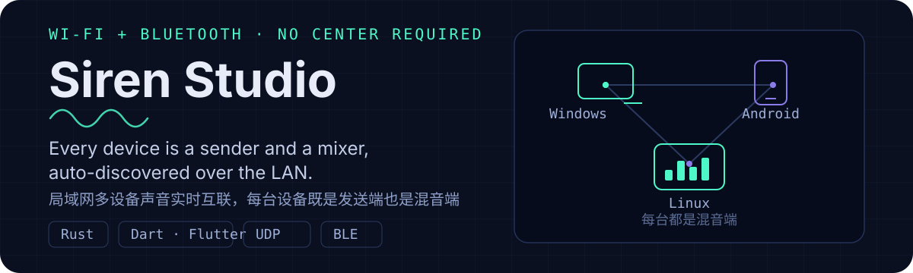
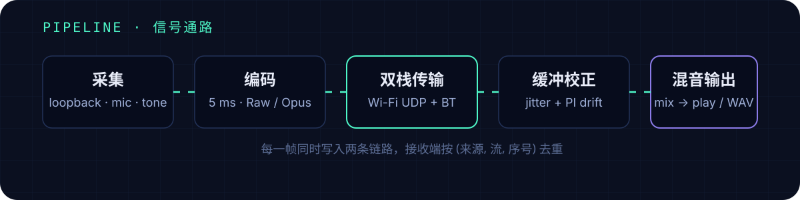

<p align="center">
  
</p>

# Siren Studio

把局域网内多台设备（Windows / Android / Linux）的声音实时互连：**每台设备既是发送端也是混音端**，mDNS 自动发现、互收互发，无需指定中心。

- 48 kHz / 立体声 / f32 统一传输格式，5 ms 帧，支持 **Raw PCM**（零编码延迟）与 **Opus**
- 每路独立环形缓冲 + PI 自适应重采样：长时间运行不漂移、不累积延迟
- **Wi-Fi + 蓝牙双栈并行**：每帧同时写两条链路，接收端按 `(来源, 流, 序号)` 去重；断网数百毫秒内自动切蓝牙，恢复后切回
- Rust 核心；Windows / Android 提供 Flutter 界面，Linux 提供无头守护 + 浏览器 WebUI

> 已完成 PC ↔ 手机 ↔ Linux 三端组网真机验证。

## 信号通路

<p align="center">
  
</p>

## 快速开始

```powershell
siren devices                       # 查看输出设备（带 * 为默认）
siren center                        # 启动中心（mDNS 广播，每秒打印电平）
siren send --to auto --source loopback   # 另一台设备：发送系统声音
siren send --to auto --source tone --freq 440 --duration 5
```

`--source` 可选 `loopback`（系统全部声音）/ `mic` / `tone`。`--record mix.wav` 只录不播；`siren analyze mix.wav --freq 440` 离线看频谱与 RMS。

Linux 无头机器：`siren web --listen 0.0.0.0:8080 --source loopback` 开 WebUI，PipeWire 桌面可加 `--isolate pipewire`（采集与播放彻底分离，零 DSP，实测发送电平 −180 dBFS、CPU 约 30%→6%）。

## 构建

```powershell
powershell -ExecutionPolicy Bypass -File scripts/build.ps1   # cargo build --release + 单元测试
```

环境要求：Windows 10/11（WASAPI）、Debian 12（PulseAudio ≥ 15 / PipeWire）、Android 8+（内录需 10+）、Rust 1.85+、VS Build Tools。Opus 由 `opus-head-sys` 源码编译，无需装 libopus。

## Raw 还是 Opus？

| | Raw f32 | Opus |
| :-- | :-- | :-- |
| 单路带宽（5 ms 帧） | ≈ 3.1 Mbps | ≈ 0.23 Mbps |
| 编码延迟 | 0 | 5 ms 帧 + 少量 |
| 丢包处理 | 补零 | PLC 丢包隐藏 |
| 适用 | 有线千兆 / 本机验证 | Wi-Fi、蓝牙、多设备 |

端到端延迟 ≈ 45–60 ms（5 ms 帧 + 30 ms 缓冲 + 网络 RTT/2 + 声卡周期）；`--target-ms` 可调。

## 网络要求

- 中心放行 **UDP 47900** 入站；mDNS 用 **UDP 5353** 组播，需同子网。
- **用 5 GHz 或有线**，关闭 AP 隔离；三台以上设备建议中心走有线。
- 手机保持前台或允许后台运行，省电模式会造成周期性欠载。

## 实测验证

`python scripts/verify_e2e.py` 依次验证 raw 双路混音、Opus 双路混音、WASAPI 系统内录、mDNS + auto 四个场景。最近一次结果：双路 RMS −12.4 dBFS、指定频率双峰、**丢包 0、欠载 0**，15 秒连续播放 0 欠载。

## 路线图

已实现：三平台采集与播放、双栈传输、去中心化组网 UI、WebUI、离线分析。
尚未实现：数据包加密 / 认证、蓝牙 A2DP Sink、Linux 桌面 GUI（当前为 WebUI）。

协议格式、DSP 参数、完整 CLI 参考与故障排查见 [DEVELOPMENT.md](DEVELOPMENT.md)。

## 许可

MIT License
